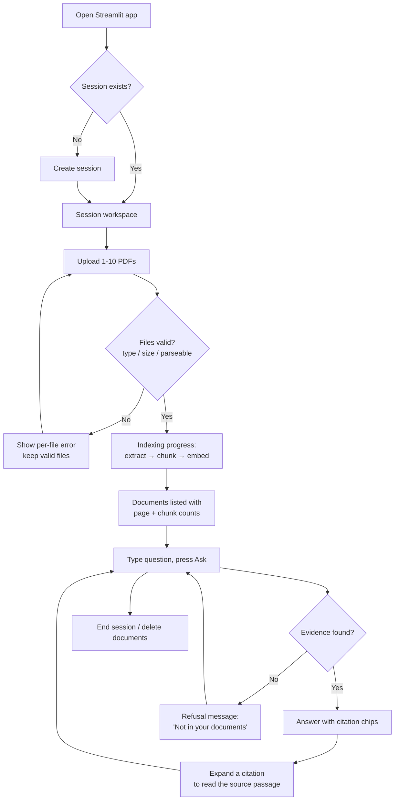
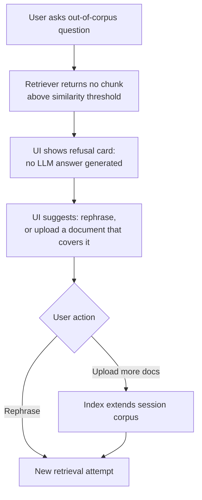
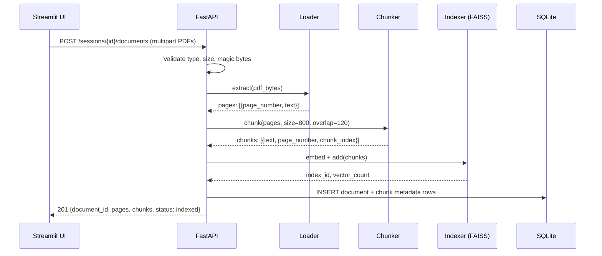
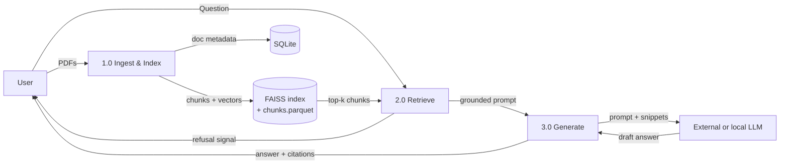
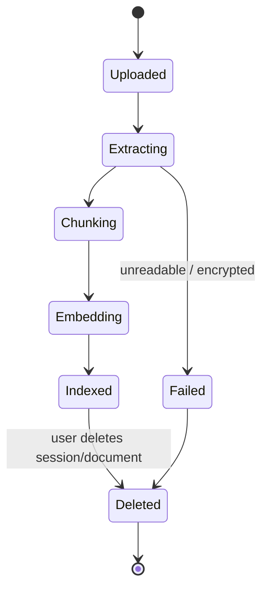

# FLOW — DocuMind user flows & system/data flows

## 1. User flow — first session (upload → answer)



## 2. User flow — refusal and recovery



## 3. System flow — ingestion pipeline



## 4. System flow — question answering (data flow)

```mermaid
sequenceDiagram
    participant UI as Streamlit UI
    participant API as FastAPI
    participant R as Retriever
    participant A as Answerer
    participant LLM as LLM backend

    UI->>API: POST /sessions/{id}/ask {question}
    API->>R: retrieve(question, k=5)
    R->>R: embed query → FAISS search → threshold ≥ 0.30
    alt no chunk passes threshold
        R-->>API: []
        API-->>UI: 200 {answer: null, refused: true, reason: "no_evidence"}
    else evidence found
        R-->>API: ScoredChunk[5] with source tags S1..S5
        API->>A: generate(question, chunks)
        A->>LLM: grounded prompt (sources tagged)
        LLM-->>A: answer text with [S#] tags
        A->>A: validate tags ⊆ retrieved set; strip invalid
        A-->>API: answer + citations[{document, page, snippet}]
        API->>API: persist message + citations (SQLite)
        API-->>UI: 200 {answer, citations, refused: false}
    end
```

## 5. Data flow summary (DFD, level 1)



## 6. State flow — document lifecycle



## 7. Notes for the implementer

- The refusal path (Flow 2, Flow 4 alt-branch) is a **feature**, not an error state — it must look deliberate in the UI (see `UI_UX_BRIEF.md` state specs).
- Citation chips in the UI map 1:1 to the `citations` array in the API response; the UI never regex-parses `[S#]` tags out of answer text.
- Ingestion is synchronous in MVP (corpora are small); the progress bar is driven by staged status responses, not websockets. If a document exceeds ~200 pages, the UI warns that indexing may take a minute.
